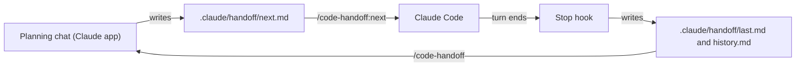
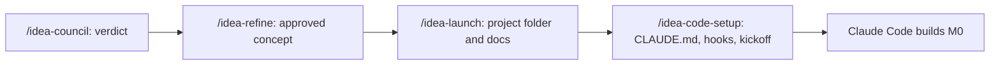

# forge-kit

forge-kit is a Claude Code plugin marketplace with two plugins, for people who plan with Claude in the app and build with Claude Code.
- **code-handoff** replaces copy-and-paste and screenshots with a two-way handoff. After every Claude Code turn, a hook writes a summary that your planning chat reads. The planning chat then writes the next prompt, which Claude Code runs with one command.
- **idea-forge** takes an idea from a chat to a project that is ready to build. A council of critics judges the idea, builders refine it, and then it writes a full documentation set and a Claude Code setup that commits and pushes as it goes.

<!-- A short GIF of the handoff loop will go here. -->
*A short GIF of the loop is coming. Until then, here's how it works:*



The idea-forge pipeline, with each step's file saved for the next step:



## Quick start

**Claude Code** (for the handoff hook and `/code-handoff:next`):
```
/plugin marketplace add bawanallahbilyaminu/forge-kit
/plugin install code-handoff@forge-kit
/plugin install idea-forge@forge-kit
```
Then run `/reload-plugins`, or restart Claude Code.

**Claude app** (the planning side, for `/code-handoff` and the idea-forge commands):
1. Download `code-handoff.plugin` and `idea-forge.plugin` from the [Releases page](https://github.com/bawanallahbilyaminu/forge-kit/releases).
2. Install them in the Claude app.
3. In each planning chat, connect your projects folder, or a project's `.claude` folder for code-handoff, with **+ → Add folder**.

**First loop:**
1. Open Claude Code in a project and do a turn. The hook creates `.claude/handoff/`.
2. In the planning chat, add that project's `.claude` folder and type `/code-handoff`. It reports what Code did and writes the next prompt.
3. Back in Claude Code, type `/code-handoff:next`.

There's more in each plugin's README:
- [code-handoff](plugins/code-handoff/README.md), including the Windows installer, which works without the plugin system
- [idea-forge](plugins/idea-forge/README.md)

## Platform support

| Platform | code-handoff hook | idea-forge git guard (in new projects) | Needs |
|---|---|---|---|
| Windows, Claude Code with Git Bash (the usual setup) | `handoff.ps1` | `git-guard.ps1` | Windows PowerShell 5.1, which is part of Windows |
| Windows, Claude Code without Git Bash | `handoff.ps1` | `git-guard.ps1` | The same |
| macOS | `handoff.mjs` | `git-guard.mjs` | Node 18 or later on the PATH |
| Linux | `handoff.mjs` | `git-guard.mjs` | Node 18 or later on the PATH |
| WSL (Claude Code running inside WSL) | `handoff.mjs` | `git-guard.mjs` | Node 18 or later inside WSL |

The plugin picks the right script itself. On macOS, Linux and WSL, both hooks exit quietly if Node isn't installed. The two versions of each hook behave the same, and the tests check that. The Windows installer is Windows-only. How it all works is in [docs/architecture.md](docs/architecture.md) and [ADR 0001](docs/adr/0001-cross-platform-hooks.md).

## Requirements
- **Claude Code** for the hooks, and **the Claude desktop app** for the planning side. idea-forge needs your projects folder connected in the app, so it can create project folders.
- **GitHub CLI** (`gh`), signed in, if you want Claude Code to create the GitHub repo for a new project.
- **On macOS, Linux and WSL:** Node 18 or later (see above).
- **Optional: [EGM](https://github.com/google/elephant-goldfish-model)** (Elephant-Goldfish Model), a plugin for designing and reviewing features with fresh agents. Projects set up by `/idea-code-setup` use it for features that need architecture decisions. Install it with `claude plugin marketplace add google/elephant-goldfish-model`, then `claude plugin install egm@egm`. Without it, those projects write a short design note instead.

## Repo layout
```
.claude-plugin/marketplace.json   the marketplace, listing both plugins
plugins/code-handoff/             Stop hook (handoff.ps1, handoff.mjs), /code-handoff:next, planning-side skill
plugins/idea-forge/               the idea pipeline: skills, references and templates
installers/windows/install.ps1    installs the handoff without the plugin system (Windows only)
scripts/                          build, checks, tests and icon scripts
tests/                            Pester and node:test tests, with synthetic fixtures
docs/                             architecture, roadmap, ADRs and release notes
```

## Contributing
Issues and pull requests are welcome. Before opening a PR:
- **Run the tests:**
  - Pester, on Windows: `powershell -NoProfile -ExecutionPolicy Bypass -File scripts/run-tests.ps1` (uses the Pester 3.4.0 that ships with Windows)
  - Node, on any OS: `node --test tests/git-guard/git-guard.test.mjs tests/handoff/handoff.test.mjs tests/handoff/parity.test.mjs tests/handoff/hook-command.test.mjs`
- **Run the checks:**
  - `scripts/check-powershell.ps1` (PowerShell 5.1 parse and ASCII-only)
  - `scripts/check-shared-refs.ps1`
  - `claude plugin validate` on each `plugin.json` and on the marketplace
  - `scripts/build-plugins.ps1`
- **CI** runs all of this on `windows-latest`, `ubuntu-latest` (Node 18 and 22) and `macos-latest`.
- **Conventions:**
  - Use Conventional Commits.
  - Bump the plugin and marketplace versions for user-visible changes, and add an entry to [CHANGELOG.md](CHANGELOG.md).
  - A change to a hook updates both its PowerShell and Node versions and both sets of tests.

The working rules for Claude Code in this repo are in [CLAUDE.md](CLAUDE.md).

## Status
v0.5.0 is the first public release. It's early, but it's tested:
- 49 Pester tests and about 70 node:test tests
- CI on all three operating systems
- used every day by its author on Windows

See [CHANGELOG.md](CHANGELOG.md) for what's in it and [docs/roadmap.md](docs/roadmap.md) for what's next.

## License
[MIT](LICENSE)
