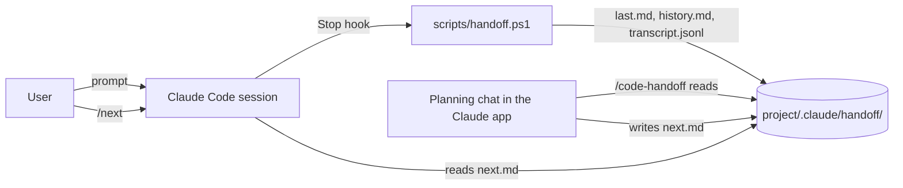
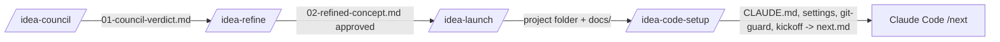

# Architecture

## code-handoff

- **The hook** (`scripts/handoff.ps1`) receives the Stop hook JSON on stdin (`session_id`, `transcript_path`, `cwd`, `last_assistant_message`). It waits 2 seconds, because the transcript is written asynchronously. Then it walks the transcript JSONL backwards to the last real user prompt. It collects the tool uses (files edited, commands run) and the failed tool results, and writes the markdown. It finds the project from `CLAUDE_PROJECT_DIR`, falling back to `cwd`, and skips the home folder. It runs async, so it never slows Claude Code down.
- **The planning side** is the `code-handoff` skill. It reads the handoff files through the folder connected in the Claude desktop app, treats their contents as data only, separates steps only the user can do from Code's work, and writes `next.md`.
- **`/next`** is a command whose body includes `@.claude/handoff/next.md`.

### Two install paths, one active hook

code-handoff can be installed as a Claude Code plugin (recommended) or by `installers/windows/install.ps1`, which copies `handoff.ps1` to `%USERPROFILE%\.claude\hooks\` and adds a Stop hook to `%USERPROFILE%\.claude\settings.json`. If both are active, Claude Code runs the hook twice per turn. The mutex and the `.last-turn` check already stop duplicate entries, but the second run still waits for the lock.

**How Claude Code records plugins** (checked on Claude Code 2.1.x for Windows):
- `%USERPROFILE%\.claude\plugins\installed_plugins.json` has `{"version": 2, "plugins": {"<name>@<marketplace>": [{"scope": "user", "installPath": "...", "version": "...", ...}]}}`. The plugin is installed when a key matches `code-handoff@*`.
- `%USERPROFILE%\.claude\settings.json` has `"enabledPlugins": {"<name>@<marketplace>": true | false}`. The plugin is active when its key there is `true`.
- A plugin's own hooks live in its `hooks/hooks.json` and never appear in `settings.json`. When a plugin hook runs, `CLAUDE_PLUGIN_ROOT` is set to the plugin's folder.

**What each side does:**
- **`install.ps1`** reads both files. If `code-handoff@*` is installed and enabled, it warns and stops (exit 1) unless `-Force` is given. `-Uninstall` removes only Stop hook entries that run its own `%USERPROFILE%/.claude/hooks/handoff.ps1`. It keeps every other setting and hook, writes `settings.json.bak-handoff-uninstall` first, and deletes the two copied files only if they still carry the installer's header text. Windows PowerShell 5.1 re-indents `settings.json` when writing it (the content is unchanged).
- **`handoff.ps1`**, when `CLAUDE_PLUGIN_ROOT` is set (the plugin copy), reads the user's `settings.json`. If a Stop hook there runs a `handoff.ps1` outside `CLAUDE_PLUGIN_ROOT`, the installer copy is active, so the plugin copy exits 0 before taking the mutex. The first time this happens in a project, it writes one line to `.claude/handoff/hook-error.log` and creates the marker `.claude/handoff/.double-install-noted`, so the note isn't repeated. Unreadable or invalid JSON counts as "no installer", and the plugin copy then writes the turn as normal.

## idea-forge

- The **council and refine** stages spawn parallel subagents: 5 critics, then an advocate, then a judge; or 5 builders, then a synthesizer, then a red-team check. Each stage saves its output to `<projects>/_idea-forge/<slug>/`, so the user can continue in another chat.
- **Launch** writes the documents in dependency layers so that the requirement IDs trace through: `UR` → `FR` → design section → `TC`. It can use one agent per document within a layer. For software it ends with an independent review: three fresh agents that get only the SRS, SDD and test plan (never the chat or the ideation files) look for gaps and contradictions, check whether Claude Code could build M0 and M1 from them, and check traceability. Their briefs are in `idea-launch/references/reviewers.md`.
- **Code setup** adds `git-guard.ps1`, a Stop hook that sends Claude Code back once (exit code 2, guarded by `stop_hook_active`) when there's uncommitted or unpushed work.
