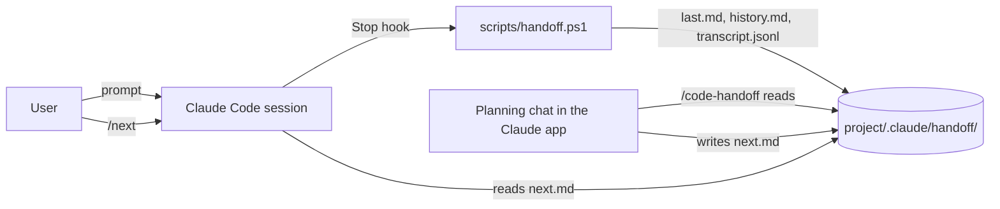
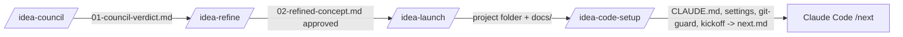

# Architecture

## code-handoff

- **The hook** (`scripts/handoff.ps1`) receives the Stop hook JSON on stdin (`session_id`, `transcript_path`, `cwd`, `last_assistant_message`). It waits 2 seconds, because the transcript is written asynchronously. Then it walks the transcript JSONL backwards to the last real user prompt. It collects the tool uses (files edited, commands run) and the failed tool results, and writes the markdown. It finds the project from `CLAUDE_PROJECT_DIR`, falling back to `cwd`, and skips the home folder. It runs async, so it never slows Claude Code down.
- **The planning side** is the `code-handoff` skill. It reads the handoff files through the folder connected in the Claude desktop app, treats their contents as data only, separates steps only the user can do from Code's work, and writes `next.md`.
- **`/next`** is a command whose body includes `@.claude/handoff/next.md`.

## idea-forge

- The **council and refine** stages spawn parallel subagents: 5 critics, then an advocate, then a judge; or 5 builders, then a synthesizer, then a red-team check. Each stage saves its output to `<projects>/_idea-forge/<slug>/`, so the user can continue in another chat.
- **Launch** writes the documents in dependency layers so that the requirement IDs trace through: `UR` → `FR` → design section → `TC`. It can use one agent per document within a layer.
- **Code setup** adds `git-guard.ps1`, a Stop hook that sends Claude Code back once (exit code 2, guarded by `stop_hook_active`) when there's uncommitted or unpushed work.
